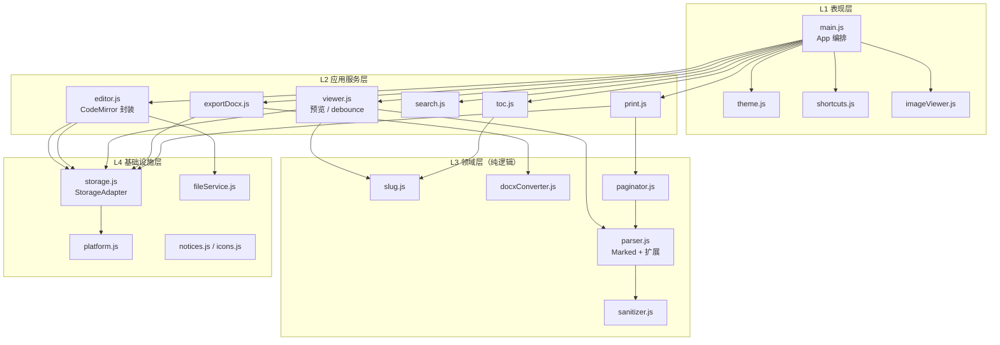
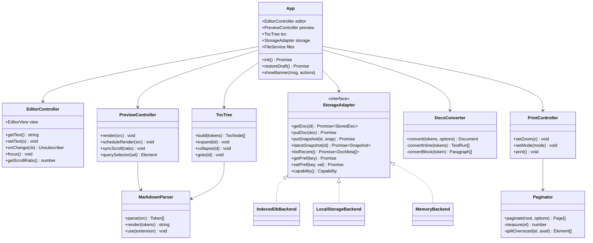
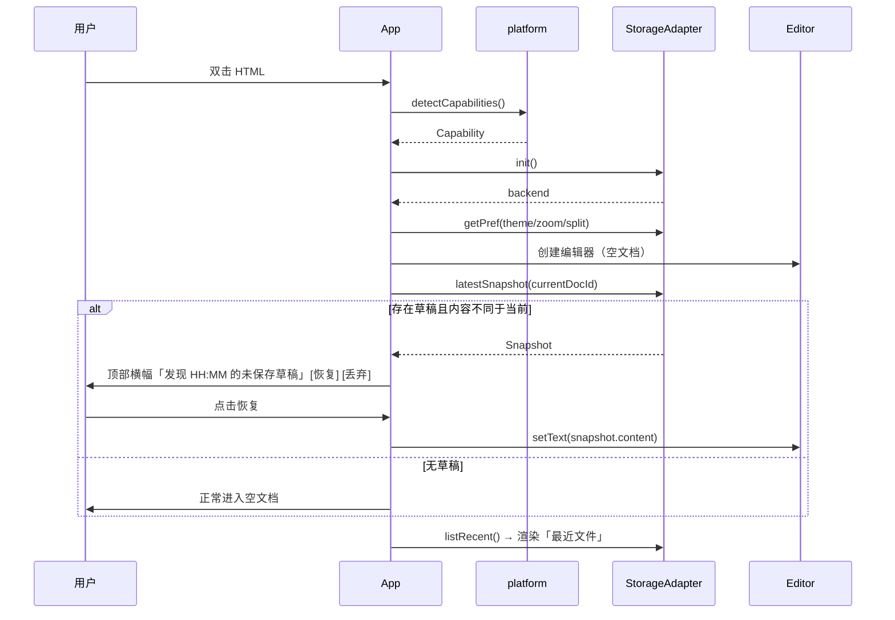
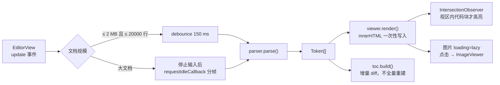
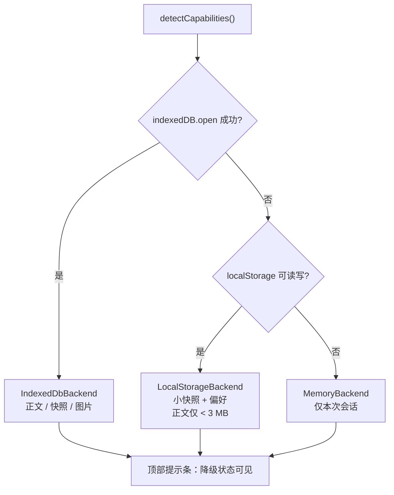

# Markdown Studio Lite — 软件设计说明书（SDD）V1.0

| 项目 | 内容 |
|---|---|
| 文档名称 | Markdown Studio Lite 软件设计说明书 |
| 版本 | V1.0（设计基线） |
| 日期 | 2026-11-06 |
| 上游文档 | Software Requirements Document（SRD）V1.0；2026-11-06 用户决策纪要 |
| 目标读者 | 实现 Agent（GitHub Copilot Agent / Claude Code / Cursor Agent）、评审人、企业合规 |
| 状态 | 设计已完成，**待用户对第 18 章未决项拍板后进入实现** |
| 参考实现 | `G:/程序/GRR/GRR_Analysis_V1.1.html` + `tools/build-release.ps1`（同类单文件离线工具，已实测） |

> 本文档描述「怎么实现」，不重复 SRD 的「要做什么」。凡与 SRD 冲突之处，**以本 SDD 及第 2.5 节 ADR 为准**，并已在第 18 章列出偏离原因。

---

## 0. 与 SRD 的关系

SRD 中有三处内在矛盾，本 SDD 予以消解：

| SRD 原文 | 矛盾 | 本 SDD 处理 |
|---|---|---|
| 「单 HTML 文件（V1）」+「V1.0 文件结构含 css/ js/ libs/」+「所有业务逻辑使用 ES6 Module」 | `file://` 下 ES Module 与 `fetch` 被 CORS 拦截，三者无法同时成立 | **双形态架构**：源码态多文件 ESM，发布态单 HTML IIFE（第 2.1、第 9 章） |
| 「禁止依赖：第三方库」+ 列出 Monaco/Marked/docx.js 等 | 自相矛盾 | 解释为「禁止重型框架与运行时依赖，允许内置 MIT/BSD 工具库」（第 12 章） |
| 「自动保存采用 localStorage」+「文档 ≤20 MB」 | localStorage 约 5 MiB 且同步阻塞 | **混合分层 + StorageAdapter**（第 4、8 章） |

---

## 1. 设计输入与约束

### 1.1 用户已确认决策（2026-11-06）

| # | 决策 | 设计落点 |
|---|---|---|
| D1 | 开发多文件，最后发布打包为单一 HTML | 第 2.1、第 9 章 |
| D2 | 需说明 IndexedDB / localStorage 优缺点 | 第 4.4、第 8.1 节；结论为混合分层 |
| D3 | 不使用有版权争议的库 | 第 12 章；许可证收敛至 MIT / BSD-3，移除字体类单独授权 |
| D4 | PDF 以保真为主 | 第 7 章；浏览器原生 print + `@page`，移除 jsPDF/html2canvas |
| D5 | 以轻量方案和实用性为主 | 全篇；编辑器、图标、公式、PDF 均做减重 |

补充隐含需求（用户随后提出）：**刷新后能恢复数据** → `StorageAdapter` 从可选升级为必做（第 8 章）。

### 1.2 硬性约束（验收红线）

| 编号 | 约束 | 验证方式 |
|---|---|---|
| C1 | 产物为单个 `.html`，双击 `file://` 可运行 | 断网 + 双击实测 |
| C2 | 产物内无外部 `src` / `href`、无 `fetch` / `XMLHttpRequest`（业务代码）、无 `import` / `export`、无 `type="module"` | 构建期正则扫描，失败即中止 |
| C3 | 运行时不依赖 Node / Python / 服务器 / 网络 / 安装 / 管理员权限 | 干净环境实测 |
| C4 | 仅使用 MIT / BSD-3 官方发布版；产物内嵌 THIRD-PARTY-NOTICES 全文并在「关于」页可见 | 合规检查 |
| C5 | 优先 Edge / Chrome（Chromium 109+） | 双浏览器验收 |
| C6 | 源码模块化、单向依赖，为 Tauri 2.x 预留替换点 | 静态检查 + 第 16 章 |
| C7 | 产物 ≤ 3 MB（优选 ≤ 2 MB），启动 < 2 s，内存 < 300 MB | 门禁 + 性能验收 |
| C8 | 所有存储访问必须 `try/catch` 并可降级，禁止因存储异常导致白屏 | 故障注入测试 |

C8 来源于对 GRR 参考实现的审查：`js/language.js` 在模块顶层直接调用 `localStorage.getItem` 且无异常保护，若企业策略禁用 DOM Storage 会直接白屏。本设计不允许该模式。

### 1.3 V1 非目标（明确不做）

- 多人协同、云同步、账号体系、评论
- 服务端渲染 / 后端 API / 数据库
- 外部插件动态加载（仅预留接口，见第 15 章）
- Markdown 以外的格式编辑（rst / org / 富文本）
- 移动端适配（三栏布局以桌面为唯一目标）
- 图片型 PDF、PDF 直接下载（保真优先，见第 7 章）

### 1.4 术语

| 术语 | 含义 |
|---|---|
| 源码态 | 仓库中的多文件 ESM 工程，供开发/维护 |
| 发布态 | 构建产出的单一 HTML，供企业分发 |
| Adapter | 隔离外部能力（存储/文件/打印）的可替换接口层 |
| Token | Marked 解析产生的结构化节点 |
| Paginator | JS 预分页引擎，见第 7.3 节 |
| Snapshot | 某一时刻的文档草稿快照 |

---

## 2. 架构总览

### 2.1 双形态架构

```
源码态（开发机）                          发布态（企业分发）
src/*.js  (ES6 Module)                  MarkdownStudioLite.html
src/styles/*.css                          <style> 全部 CSS（含 print.css）
vendor/*.js (UMD / 预打包 IIFE)    ──►    <script> 全部库 + 业务 IIFE
vendor/*-LICENSE                          <details> THIRD-PARTY-NOTICES
lang/*.json                               globalThis.__MDSL_I18N = {...}
build-release.ps1 (零安装 PowerShell)     单文件，file:// 双击即用
```

**关键决策**：发布机上不允许出现 Node。因此：
- 自研业务模块：`import/export` 用构建脚本改写为 IIFE + 常量注入（复刻 GRR 做法）
- 第三方 ESM 库（CodeMirror 6 无官方 UMD）：**在仓库中签入预先生成的 `vendor/cm6.iife.js`**（开发机一次性用 esbuild 生成，附生成脚本与许可证），发布机只做内联拼接
- 若最终选用 CodeMirror 5（有官方 UMD 单文件），可完全去掉 esbuild，实现 100% 零安装构建 —— 见第 18 章 OPEN-01

### 2.2 分层

| 层 | 模块 | 职责 | 允许依赖 |
|---|---|---|---|
| L1 表现层 | `main.js`, `theme.js`, `shortcuts.js`, `imageViewer.js` | DOM 装配、事件绑定、主题、快捷键 | L2, L4 |
| L2 应用服务层 | `editor.js`, `viewer.js`, `toc.js`, `search.js`, `print.js`, `exportDocx.js` | 编排业务流程，不含渲染细节 | L3, L4 |
| L3 领域层 | `parser.js`, `docxConverter.js`, `paginator.js`, `sanitizer.js`, `slug.js` | 纯函数/纯类：解析、转换、分页、清洗 | 无（仅接受入参） |
| L4 基础设施层 | `storage.js`, `fileService.js`, `notices.js`, `icons.js`, `platform.js` | 存储、文件 IO、平台能力探测、常量 | 浏览器 API |

**依赖规则**：只能自上而下依赖，禁止反向与跨层环；L3 必须可独立单测（不触碰 DOM / storage）。

### 2.3 架构图



### 2.4 运行时约束清单

| 禁止 | 原因 | 替代 |
|---|---|---|
| `type="module"` / `import` / `export` | `file://` CORS | 构建期改写为 IIFE |
| `fetch` / `XMLHttpRequest` 加载本地资源 | `file://` CORS | 构建期内联 |
| Web Worker / Service Worker / SharedWorker | 单文件内联 worker 在 `file://` 下不可靠 | 全主线程 + 分帧（`requestIdleCallback`） |
| 外部字体文件（woff/ttf） | 字体单独授权（OFL）风险 + 需 base64 内联 | 系统字体栈；公式走 MathML |
| `document.write`、动态 `eval` | 企业 CSP / 安全审查 | 静态 DOM API |
| CSS `@import`、外部 `url()` | 离线 | 内联 / data URI |

### 2.5 架构决策记录（ADR）

| ID | 决策 | 备选 | 理由 |
|---|---|---|---|
| ADR-001 | 双形态：源码 ESM → 发布 IIFE | 纯单文件手写 / 要求本地服务器 | 同时满足「双击可跑」与「模块化 + Tauri 友好」 |
| ADR-002 | 混合存储 + StorageAdapter | 全 localStorage / 全 IndexedDB | 大正文异步不阻塞；小偏好同步即时；可降级；Tauri 单点替换 |
| ADR-003 | PDF 走原生 print + `@page` | jsPDF + html2canvas | 文字可选中、分页精准、零依赖、保真优先 |
| ADR-004 | 图标用内联 SVG | Lucide(ISC) | ISC 不一定在企业白名单；零依赖零声明 |
| ADR-005 | 许可证收敛 MIT/BSD-3 + 内嵌 Notices | CDN / 二次打包版 | 满足「保留版权声明」义务，离线可审计 |
| ADR-006 | 构建用零安装 PowerShell 脚本 | 发布机装 Node/esbuild | 企业受限环境无安装权限 |
| ADR-007 | 不使用 Web Worker | — | `file://` 内联 worker 风险高，收益不抵复杂度 |
| ADR-008 | 原始 HTML 走白名单清洗 | DOMPurify（Apache-2.0/MPL 双许可） | 避免双许可争议，且更轻 |
| ADR-009 | 恢复草稿需用户确认，不自动覆盖 | 静默恢复 | 避免误恢复覆盖用户当前编辑 |
| ADR-010 | 页眉/页码不依赖 CSS margin boxes | `@page { @bottom-right ... }` | **Chromium 不支持 CSS Paged Media margin boxes**（第 7.2 节） |

---

## 3. 模块设计

### 3.1 模块清单

| 文件 | 类/对象 | 主要职责 | 依赖 |
|---|---|---|---|
| `src/main.js` | `App` | 启动装配、生命周期、全局状态、横幅提示 | 全部 L2/L4 |
| `src/editor.js` | `EditorController` | CodeMirror 实例、文档变更事件、只读/焦点、光标同步 | `platform` |
| `src/parser.js` | `MarkdownParser` | Marked 配置、renderer 扩展、token 产出 | Marked, Prism, Temml |
| `src/sanitizer.js` | `sanitizeHtml()` | 标签/属性白名单清洗，防 XSS | 无 |
| `src/slug.js` | `slugger()` | 标题锚点生成（中文、去重、URL 编码） | 无 |
| `src/viewer.js` | `PreviewController` | 渲染 HTML、debounce、滚动同步、懒高亮、图片代理 | parser, slug |
| `src/toc.js` | `TocTree` | 标题树构建、展开收起、点击跳转、hash 同步 | slug |
| `src/search.js` | `SearchController` | 调用 CM6 search、Ctrl+F/H、替换全部 | editor |
| `src/imageViewer.js` | `ImageViewer` | 弹出层、100/150/200%/Fit、滚轮缩放 | 无 |
| `src/print.js` | `PrintController` | 打印模式、缩放、调用 Paginator、`window.print()` | paginator, parser |
| `src/paginator.js` | `Paginator` | 预分页测量、切页、页眉页脚注入 | 无（纯 DOM 测量） |
| `src/exportDocx.js` | `DocxExporter` | 组装 `Document`、触发下载 | docxConverter |
| `src/docxConverter.js` | `DocxConverter` | token → docx 元素树（纯逻辑） | docx.js 类型 |
| `src/storage.js` | `StorageAdapter`, `IndexedDbBackend`, `LocalStorageBackend`, `MemoryBackend` | 文档/快照/偏好/最近文件 | `platform` |
| `src/fileService.js` | `FileService` | 打开、拖拽、Save、Save As、最近文件 | storage |
| `src/theme.js` | `ThemeController` | Light/Dark/跟随系统、`prefers-color-scheme` | storage |
| `src/shortcuts.js` | `ShortcutRegistry` | 全局快捷键注册与冲突检测 | 无 |
| `src/platform.js` | `detectCapabilities()` | 能力探测、降级判定 | 无 |
| `src/icons.js` | `ICONS` | 内联 SVG 常量表 | 无 |
| `src/notices.js` | `NOTICES` | 第三方声明数据源（构建期注入） | 无 |

### 3.2 类图



### 3.3 依赖矩阵（行依赖列）

| | parser | sanitizer | slug | storage | platform | editor | viewer | toc | print | docx |
|---|---|---|---|---|---|---|---|---|---|---|
| main | ✓ | | | ✓ | ✓ | ✓ | ✓ | ✓ | ✓ | ✓ |
| editor | | | | ✓ | ✓ | — | | | | |
| viewer | ✓ | ✓ | ✓ | | | | — | | | |
| toc | ✓ | | ✓ | | | | | — | | |
| print | ✓ | | | | | | | | — | |
| exportDocx | ✓ | | | ✓ | | | | | | — |

规则：L3（parser/sanitizer/slug/docxConverter/paginator）之间不得互相循环依赖；`main.js` 是唯一允许引用全部 L2 的模块。

### 3.4 关键接口签名

```js
// storage.js
export interface Capability {
  backend: 'indexeddb' | 'localstorage' | 'memory';
  indexedDB: boolean;
  localStorage: boolean;
  persistent: boolean;
  reason?: string;
}
export interface StoredDoc {
  id: string; name: string; content: string;
  updatedAt: number; version: number;
}
export interface Snapshot {
  docId: string; at: number; content: string; name: string;
  trigger: 'interval' | 'hidden' | 'beforeunload' | 'manual';
}
export interface StorageAdapter {
  init(): Promise<Capability>;
  getDoc(id: string): Promise<StoredDoc | null>;
  putDoc(doc: StoredDoc): Promise<void>;
  deleteDoc(id: string): Promise<void>;
  putSnapshot(snap: Snapshot): Promise<void>;
  latestSnapshot(docId: string): Promise<Snapshot | null>;
  clearSnapshots(docId: string): Promise<void>;
  listRecent(): Promise<DocMeta[]>;
  touchRecent(meta: DocMeta): Promise<void>;
  getPref<T>(key: string, fallback: T): Promise<T>;
  setPref<T>(key: string, value: T): Promise<void>;
  capability(): Capability;
}

// parser.js
export function createParser(options: ParserOptions): MarkdownParser;

// docxConverter.js
export function convertTokens(
  tokens: Token[],
  options: { resolveImage(src: string): Promise<ImageData | null>; styles: DocxStyles }
): Promise<Document>;

// paginator.js
export function paginate(
  sourceRoot: HTMLElement,
  options: { pageWidthMm: number; pageHeightMm: number;
             marginMm: Margin; headerMm: number; footerMm: number }
): DocumentFragment;

// platform.js
export function detectCapabilities(): Promise<Capability>;
```

---

## 4. 数据模型

### 4.1 核心实体

```js
interface DocMeta   { id: string; name: string; size: number; openedAt: number; source: 'file' | 'draft' }
interface TocNode   { id: string; level: 1|2|3|4|5|6; text: string; children: TocNode[]; line?: number }
interface Preferences { theme: 'light'|'dark'|'system'; zoom: number;
                        splitRatio: number; tocCollapsed: string[];
                        printMode: 'read'|'print'; lang: 'zh'|'en' }
interface DocxStyles { font: string; headingFont: string; codeFont: string;
                       pageSize: 'A4'|'LETTER'; marginMm: Margin }
```

### 4.2 IndexedDB Schema

| 项 | 值 |
|---|---|
| DB 名称 | `mdstudio` |
| 版本 | `1`（预留 `onupgradeneeded` 迁移钩子） |
| store `documents` | keyPath `id`；index `by_updated` → `updatedAt` |
| store `snapshots` | keyPath `[docId, at]`；index `by_doc` → `docId`；**每个文档仅保留最近 3 份**，写入后裁剪 |
| store `images` | keyPath `key`（data URI / Blob 缓存，按需） |

**为什么正文放 IndexedDB**：异步不阻塞 UI；可存 Blob/大字符串；实测配额约 10 GB（见 4.4），20 MB 文档无压力；有事务保证。

### 4.3 localStorage Keys（仅小数据）

| Key | 内容 | 上限 |
|---|---|---|
| `mdstudio.prefs` | Preferences JSON | < 2 KB |
| `mdstudio.recent` | DocMeta[]（最多 10 条，**不含正文**） | < 5 KB |
| `mdstudio.emergency` | 崩溃时的紧急草稿（**压缩后**，见 8.4） | < 1.5 MB |

**为什么偏好放 localStorage**：同步读取、启动即时生效、体量极小。所有读写必须 `try/catch`。

### 4.4 能力探测与实测依据

`detectCapabilities()` 启动时依次探测：`indexedDB.open` → `localStorage` 读写 → 全部失败则 `memory`。所有异常必须捕获并转为用户可见的降级提示条（不阻断主功能）。

**实测环境**：Microsoft Edge（Chromium 内核，headless=new），`file://` 页面，2026-11-06。

| API | file:// 默认 | 加 `--allow-file-access-from-files` |
|---|---|---|
| `isSecureContext` | `true` | `true` |
| `localStorage` | OK | OK |
| `sessionStorage` | OK | OK |
| `indexedDB.open()` | **OK** | **OK** |
| `caches.open()` | OK | OK |
| `navigator.storage.estimate()` | quota ≈ 10 GiB | 同 |
| `showSaveFilePicker` | 函数存在 | 函数存在 |

结论：**无需放宽浏览器标志即可使用 IndexedDB**，D2 的混合分层方案在 `file://` 下成立。企业组策略仍可能禁用，故降级链为必需项（C8）。`showSaveFilePicker` 虽存在，但需用户手势且 `file://` 下权限行为不稳定，V1 不采用（见第 18 章 OPEN-04）。

---

## 5. 关键流程

### 5.1 启动与草稿恢复



设计要点（ADR-009）：**绝不静默覆盖**。用户点击恢复才写入编辑器；丢弃则清理快照。

### 5.2 编辑 → 解析 → 预览



- 刷新目标 < 200 ms（SRD）；大文档切换为「停止输入后渲染」并在状态栏标注
- 预览容器使用 `innerHTML` 整体替换，但滚动位置在替换前后保存/恢复，避免跳动
- 滚动同步：按 `(scrollTop / (scrollHeight - clientHeight))` 比例映射，带节流；用户手动滚动预览时暂停反向同步 300 ms

### 5.3 Markdown 解析扩展管线

`MarkdownParser` 基于 Marked 的 `marked.use({ hooks, renderer, walkTokens })`：

| 扩展点 | 处理 | 安全/兼容 |
|---|---|---|
| `heading` | 生成 `id`（slugger 去重，`encodeURIComponent` 处理中文），注入锚点 `<a class="anchor">` | 防重复 id 导致 hash 跳转错乱 |
| `code` | 输出 `<pre><code class="language-x" data-src>`，**不立即高亮**，由 observer 调用 Prism | 避免大文档一次性高亮卡顿 |
| `codespan` | 转义 + 等宽样式 | — |
| `image` | 解析相对路径 → `ImageResolver`；产出 `data-src` 懒加载；绑定点击打开查看器 | 禁止自动请求外部 URL |
| `link` | 外链强制 `rel="noopener noreferrer"`，`target="_blank"`；`javascript:` 协议丢弃 | 防 XSS / 反向链接泄露 |
| `html`（原始 HTML） | 交由 `sanitizer`：标签白名单（`p,br,strong,em,u,s,ul,ol,li,table,thead,tbody,tr,th,td,blockquote,code,pre,hr,img,span,div,sub,sup`）+ 属性白名单（`class,id,href,src,alt,title,width,height,colspan,rowspan,align`） | 移除 `on*`、`style`、`script`、`iframe`、`object`、`form`；ADR-008 |
| `math` | `$$…$$` / `$…$` → Temml 输出原生 MathML（Chromium 109+） | 零字体文件、零 OFL 风险 |
| `table` | GFM 表格，输出带 `thead` 的结构 | 为打印跨页表头重复做准备 |

`slugger()` 规则：小写 → 去除 Markdown 标点 → 空白转 `-` → 中文保留 → `encodeURIComponent` → 冲突追加 `-2/-3`。同一文档内维护计数器，每次全量解析前重置。

### 5.4 自动保存与崩溃恢复

| 触发 | 行为 |
|---|---|
| 编辑后 2 s 空闲 | 置 `dirty = true`（仅标记，不写盘） |
| 每 30 s（`setInterval`） | 若 dirty → `putSnapshot({trigger:'interval'})`，清 dirty |
| `visibilitychange → hidden` | 立即写一次快照 + 写 `mdstudio.emergency`（压缩小副本） |
| `pagehide` / `beforeunload` | 尝试同步写 `mdstudio.emergency`（localStorage 同步，作为异步 IndexedDB 的最后保险） |
| 手动 Ctrl+S | `putDoc()` + 清快照 + 更新最近文件 |

**紧急草稿**：用轻量 LZ 压缩（自研 ~60 行，不引入 lz-string 以控制依赖）后写 localStorage；若压缩后仍 > 1.5 MB，只写前 1.5 MB 并标记 `truncated`，恢复时提示用户「草稿不完整，建议使用最近保存的文件」。

**快照裁剪**：每次写入后删除该 `docId` 第 4 份及更早的快照，控制容量。

### 5.5 文件打开 / 保存 / 拖拽

- 打开：`<input type="file" accept=".md,.markdown">` + `File.text()`；拖拽监听 `dragover/drop` 于编辑区与整个窗口，阻止默认导航
- 保存：`Blob` + `URL.createObjectURL` + `<a download>`，文件名取原文件名，无原名时 `untitled.md`
- Save As：始终弹下载（浏览器不提供另存对话框）
- 最近文件：仅存 `DocMeta`（名/大小/时间），**不存正文**；点击条目时若 `documents` 中有对应 `id` 则从 IndexedDB 读回，否则提示重新选择文件
- 大文件：≤ 20 MB 直接读；> 20 MB 提示「超出设计容量，可能卡顿，是否继续」

### 5.6 TOC 生成与跳转

`TocTree.build(tokens)` 单次线性扫描 heading token，用栈构造 `TocNode[]`（层级回退时出栈）。展开/收起仅切换 CSS class，不重建 DOM。点击 → `viewer.querySelector('#'+CSS.escape(id)).scrollIntoView()` + `history.replaceState(null,'','#'+id)`；启动时读取 `location.hash` 自动定位。URL hash 示例：`#grr-study`。

### 5.7 搜索 / 替换

直接复用 CodeMirror 6 `@codemirror/search`（原生多光标、匹配高亮、上下跳转、替换/全部替换），不重复造轮子。`Ctrl+F` / `Ctrl+H` 由 `ShortcutRegistry` 拦截并调用 `openSearchPanel` / `replaceAll`；`Escape` 关闭。

### 5.8 图片查看器

预览区图片点击 → 自定义 `<dialog>` 弹出层；工具栏 100% / 150% / 200% / Fit Window；滚轮以光标位置为中心缩放（0.1 步进，限 25%–400%）；`Escape` / 点击遮罩关闭；拖拽平移。不引入任何灯箱库。

### 5.9 打印 / PDF

见第 7 章。菜单 `File → Export PDF`（`Ctrl+Shift+P`）实际调用 `PrintController.print()` → `window.print()`，由用户在打印对话框选择「另存为 PDF」。状态栏与弹层明确提示该步骤（GRR 参考实现采用同样的交互）。

### 5.10 DOCX 导出

见第 6 章。菜单 `File → Export DOCX`（`Ctrl+Shift+W`）→ `DocxConverter.convertTokens()` → `Packer.toBlob()` → `<a download>`，文件名 `原文件名.docx`。大文档用 `requestIdleCallback` 分帧构建，避免长时间阻塞。

---

## 6. Markdown → DOCX 映射架构

### 6.1 转换器结构

`DocxConverter` 为纯逻辑类（L3），输入 `Token[]` + `options`，输出 docx.js `Document`。分两条递归路径：`convertBlock(token)` 与 `convertInline(tokens)`。**不依赖 DOM、不依赖编辑器状态**，可单测。

### 6.2 映射表

| Markdown Token | docx.js 构造 | 说明 |
|---|---|---|
| `heading` depth 1 | `Paragraph({ heading: HeadingLevel.TITLE })` 或 `HEADING_1` | SRD 要求 → Word Heading1 |
| `heading` depth 2–6 | `HEADING_2` … `HEADING_6` | 保留大纲级别，便于 Word 导航窗格 |
| `paragraph` | `Paragraph({ children: TextRun[] })` | — |
| `text` | `TextRun({ text })` | 合并相邻同格式文本，减少节点数 |
| `strong` / `em` / `del` | `TextRun({ bold / italics / strike })` | 嵌套时合并样式位 |
| `codespan` | `TextRun({ font: codeFont, shading, color })` | — |
| `link` | `ExternalHyperlink({ children: [TextRun({ style:'Hyperlink' })] })` | — |
| `blockquote` | `Paragraph({ indent:{left}, border:{left} })` | 递归处理内部块 |
| `list` / `list_item` | `Paragraph({ numbering:{ reference, level } })` | 预定义 numbering reference；有序/无序分开 |
| `table` | `Table({ rows: TableRow({ children: TableCell({ children:[Paragraph] }) }) })` | `token.align` → `alignment`；`thead` 首行加粗 + `tableHeader: true`（跨页重复） |
| `code` | 每行一个 `Paragraph`，等宽字体 + 底纹 + 保留空格 | 不做语法着色（Word 中价值低且增复杂度） |
| `image` | `ImageRun({ data, transformation:{width,height} })` | 由 `resolveImage()` 返回字节；见 6.3 |
| `hr` | `Paragraph({ border:{ bottom } })` | — |
| `html` | 经 `sanitizer` 后按纯文本或白名单块处理 | 不执行脚本 |
| `math` | Word 原生可编辑 OMML 公式（MathML → OMML，V1.2 起） | 转换失败降级为红色等宽源码并计数 |

### 6.3 图片解析策略

**V1 实现（V1.5 图片内嵌补齐后）**：`resolveImage()` 由 `src/imageData.js` 的 `decodeImageForDocx()` 提供，只处理两类输入：

1. `data:image/(png|jpeg|gif|bmp);base64,...` —— 直接 `atob` 解码成字节，保留原格式（GIF、JPEG 体积不被破坏）；
2. 其它内嵌 data URI（webp / avif / svg+xml / 百分号编码）与同源 `blob:` —— 用 `Image` + `canvas` 栅格化为 PNG 再解码。

导出时图片等比限制在 560 px 宽；独占一个段落的图片在 Word 中居中。`http(s):` 外链和相对路径**不主动请求**（`file://` 下浏览器读不到同目录图片，离线环境也不应发网络请求），降级为占位文本 `[图片: alt]`，且 `imageFailures` 计数会出现在状态栏，不静默丢弃。

图片进入文档靠「编辑器内嵌」而不是路径引用：`Ctrl+V` 粘贴截图，或把 png/jpg/webp/svg 等图片文件拖进窗口（`imageFilesFromClipboard()` / `imageFilesFromDataTransfer()`），`fileToMarkdownImage()` 生成 `` 插到光标处并自成一段；原生格式且 ≤ 2 MB / ≤ 2000 px 时保留原字节，大图或 Word 不认识的格式自动栅格化压缩（上限 1600 px，过大再降为 JPEG 0.8）。图片随 `.md` 与 IndexedDB 快照一起保存，离线预览、打印与 DOCX 导出均可用。

> 原计划中的 Blob 相对路径缓存与 IndexedDB `images` store 未启用：内嵌 data URI 已覆盖该场景，且避免单文档工具引入额外状态；`images` store 保留在 schema 中供后续多附件版本使用。

**已知限制**：预览区仍按浏览器默认行为加载 `http(s):` 外链图片（会产生一次网络请求，离线时裂图），但 DOCX 不会把它们带进去。

### 6.4 样式与页面设置

内置 `styles.xml` 默认定义（Title / Heading1–6 / Normal / Code / Quote / Hyperlink），`section` 设置 A4、页边距、页眉（文档标题 + 日期）、页脚（`PageNumber.CURRENT` / `TOTAL_PAGES`）。字体使用系统字体名（不嵌字体文件，避免授权）。

---

## 7. 打印与分页设计

### 7.1 目标与能力边界

SRD 要求：A4、页边距 15/15/20/20 mm、页码 `Page X of Y`、页眉（文档标题 + 日期）、缩放档位、阅读/打印双模式。

### 7.2 重要技术边界：Chromium 不支持 CSS Paged Media margin boxes（ADR-010）

以下代码在 Edge / Chrome 中**不生效**，不得作为实现依据：

```css
/* 无效：Chromium 不支持 */
@page { @bottom-right { content: "Page " counter(page) " of " counter(pages); } }
```

Chromium 支持 `@page { size; margin }`、`break-before/after/inside`、`orphans/widows`、`thead { display: table-header-group }`；**不支持** margin boxes、`counter(page)` / `counter(pages)`、`string-set` / `string()`。因此「Page X of Y」和自定义页眉只能：

| 方案 | 实现 | 优点 | 缺点 | V1 取舍 |
|---|---|---|---|---|
| A 浏览器打印对话框 | 提示用户勾选「页眉和页脚」 | 零代码、保真好 | 内容/样式不可控，页码格式由浏览器决定 | **默认保底** |
| B JS 预分页 Paginator | 把内容切成 `.print-page`，每页内嵌页眉/页脚 DOM，JS 填 `Page i of n` | 精确可控、文字可选中 | 需测量与切分，复杂度较高 | **V1 实现（可开关）** |
| C 图片型 PDF | html2canvas + jsPDF | — | 有损、无可选文字 | 明确否决（D4） |

### 7.3 Paginator 算法

```
输入：单一打印容器 #print-source（宽度 = 210 - 20 - 20 = 170 mm）
可用正文高度 H = 297 - 15 - 15 - headerH - footerH

1. 克隆源内容到隐藏测量容器（宽度 170 mm，样式与打印一致）
2. 遍历顶层块节点，累计 offsetHeight + margin
3. 若 当前页已用高度 + 块高 ≤ H → 放入当前页
   否则 → 新建一页
4. 单块高度 > H（长表格 / 长代码块）：
   - table：按 <tr> 切分，跨页时复制 <thead>
   - pre：按行切分
   - 其他：允许跨页（不做原子保护）
5. 应用避分页规则：
   h1~h6 / 图片 / 代码块 / 表格行 / 公式 → break-inside: avoid
   标题后至少保留 1 行正文（widows/orphans: 3）
6. 生成 N 个 .print-page，每页注入：
   页眉：Document Title + Date
   页脚：Page i of N
7. @media print { .print-page { break-after: page } .print-page:last-child { break-after: auto } }
```

**测量精度**：使用 `getBoundingClientRect()`，字体加载完成后再测量（`document.fonts.ready`）；打印前一次性重算，缩放档位变化时重算。缩放通过 CSS `zoom`（Chromium 支持）实现，仅影响屏幕预览，不改变 `@page` 物理尺寸。

### 7.4 打印模式 UI

| 元素 | 行为 |
|---|---|
| 阅读模式 | 三栏布局，正常 DOM |
| 打印模式 | 隐藏 TOC/编辑器，居中显示 A4 纸张（白底 + 阴影），显示分页边界 |
| 缩放 | 50/75/100/125/150/200% + `+` / `-` / Fit Width / Fit Page |
| 页边距 | 固定 15/15/20/20 mm（SRD），V1 不做用户自定义 |
| 方向 | A4 纵向 / 横向（切换时重算 Paginator） |

---

## 8. 存储与持久化设计

### 8.1 三后端与降级链



**所有后端实现同一 `StorageAdapter` 接口**，`App` 只依赖接口，不感知后端。任何后端异常均被捕获并降级，不抛到启动流程（C8）。

### 8.2 IndexedDB vs localStorage 对照（D2 的完整答复）

| 维度 | localStorage | IndexedDB |
|---|---|---|
| API | 同步 | 异步（Promise） |
| 容量 | ≈ 5 MiB（UTF-16 计） | 实测配额 ≈ 10 GiB |
| 20 MB 文档 | 不支持 | 支持 |
| 大文档写入 | **阻塞主线程**，违反「编辑不卡顿」 | 不阻塞 |
| 数据类型 | 仅字符串 | 对象 / Blob / ArrayBuffer |
| 事务 / 多版本快照 | 无 | 有 |
| 查询索引 | 无 | 有 |
| 启动读取 | 即时（适合偏好） | 需 await |
| 企业策略禁用 | 可能 | 可能 |

**结论**：正文/快照/图片 → IndexedDB；偏好/最近文件元数据/紧急草稿 → localStorage。两者互补，不是二选一。

### 8.3 数据一致性

- 文档 `version` 单调递增；写入用 IndexedDB 事务保证原子性
- 快照与文档分离，恢复时比较 `snapshot.at > document.updatedAt` 才提示
- 手动保存后 `clearSnapshots(docId)`，避免恢复出旧内容
- 多标签页：用 `BroadcastChannel`（不可用则 `storage` 事件）广播 `doc-saved`，其它标签页刷新最近文件列表；**不做自动合并**，冲突时提示用户

### 8.4 Tauri 替换点

`StorageAdapter` 是唯一需要替换的模块：迁 Tauri 时新增 `FsStorageAdapter`（调用 `@tauri-apps/plugin-fs`），`App` 与所有 L2/L3 代码不变。见第 16 章。

---

## 9. 构建与发布设计

### 9.1 输入与输出

| | 路径 |
|---|---|
| 输入 | `src/`、`vendor/`、`licenses/`、`lang/`、`src/index.template.html` |
| 脚本 | `tools/build-release.ps1`（PowerShell 5.1，Windows 自带，零安装） |
| 输出 | `dist/MarkdownStudioLite.html` |

### 9.2 构建步骤（严格顺序）

1. 读取 `index.template.html`
2. 替换 `<link rel="stylesheet" href="css/app.css">` 等占位为 `<style>` 内联块（app / dark / print 三段）
3. Logo / 图标：`assets/*.svg|png` → 内联 SVG 或 base64 data URI
4. 内联 vendor：按固定顺序注入 `<script>` 块；对每个库内容做 `</script` → `<\/script` 转义
5. 业务模块改写：按 `moduleOrder` 数组读取 `src/*.js`，正则处理
   - `import {a,b} from "./x.js";` → `const {a,b} = __mdsl_x;`
   - `export function f` / `export const c` → 去掉 `export`，收集导出名
   - 非入口模块包成 `const __mdsl_x = (()=>{ ...; return {导出名}; })();`
   - 入口 `main.js` 包成 `(async()=>{ ... })();`
6. 注入全局常量：`globalThis.__MDSL_I18N = {...}`、`globalThis.__MDSL_NOTICES = {...}`
7. 注入 THIRD-PARTY-NOTICES：读取 `licenses/*` 全文，HTML 转义后放入 `<details class="third-party-notices">`
8. 移除开发期标记：`file-warning` 提示块、`file:` 协议检测脚本
9. **产物自检（任一失败即中止）**：
   - 无 `type="module"`、无 `import` / `export` 语句残留
   - 无 `src="` / `href="` 指向 `css|js|vendor|assets|lang`（data URI 除外）
   - 业务脚本段无 `fetch(` / `XMLHttpRequest`
   - NOTICES 块存在且非空
   - 体积 ≤ 3 MB（> 2 MB 仅告警）
10. UTF-8 无 BOM 写出

### 9.3 与参考实现的关系

`G:/程序/GRR/tools/build-release.ps1` 已验证此模式可行（1.7 MB 单文件、`file://` 双击可用、运行时零网络请求）。本设计复用其骨架，扩展了三点：模块白名单校验、业务段网络 API 扫描、许可证块存在性断言。

---

## 10. 性能设计

| SRD 指标 | 设计手段 |
|---|---|
| 10 万行编辑不卡顿 | CodeMirror 6 视区渲染（仅渲染可见行） |
| 20 MB 文档 | 字符串单次驻留；不做全文正则扫描；解析按 debounce 触发 |
| 预览 < 200 ms | debounce 150 ms；innerHTML 单次写入；TOC 增量 diff；大文档切换 idle 渲染 |
| 启动 < 2 s | 单文件本地加载、零网络；偏好同步读，正文异步恢复 |
| 内存 < 300 MB | 库常驻约 30–60 MB；快照只留 3 份；图片 Blob 用后释放；预览 DOM 整体替换避免累积 |

补充策略：
- 代码块高亮由 `IntersectionObserver` 触发，只处理视区
- 图片 `loading="lazy"`，预览区不解码非可视图片
- 长文档不启用全局滚动同步（> 2 MB 时自动降级）
- DOCX 构建用 `requestIdleCallback` 分帧，进度条可见
- 所有 `setInterval` 在 `pagehide` 时清理

---

## 11. 安全设计

| 风险 | 措施 |
|---|---|
| 原始 HTML 注入 / XSS | `sanitizer` 白名单；移除 `on*`、`style`、`javascript:`、`script/iframe/object/form` |
| 外部链接 | `rel="noopener noreferrer"`；禁止自动加载远程图片 |
| 本地文件越权 | 只处理用户显式选择/拖入的文件；不扫描目录、不读取任意路径 |
| 数据外泄 | 无网络 API；构建期扫描业务代码不含 `fetch`/`XHR`/`WebSocket`/`sendBeacon` |
| 存储异常导致白屏 | 所有存储访问 `try/catch` + 降级（C8，源于 GRR 审查发现） |
| 恶意 `.md` 超大文件 | 20 MB 提示阈值；解析超时保护（> 5 s 中止并提示） |

---

## 12. 合规与第三方组件

### 12.1 组件清单（全部宽松许可）

| 用途 | 组件 | 许可证 | 发布形态 |
|---|---|---|---|
| 编辑器 | CodeMirror 6（`state/view/commands/search/language/lang-markdown/lezer-highlight`） | MIT | `vendor/cm6.iife.js`（预打包并签入） |
| Markdown 解析 | Marked | MIT | UMD 官方 min 版 |
| 代码高亮 | Prism.js（仅 ~15 语言） | MIT | 经典脚本 + 语言组件 |
| 公式 | Temml → 原生 MathML | MIT | 经典脚本（无字体文件） |
| Word 导出 | docx.js | MIT | UMD 官方版 |
| 图标 | 内联 SVG（自研） | 项目自有 | 源码常量 |
| PDF | 浏览器原生 print | — | 零依赖 |
| 构建（仅开发机） | PowerShell 5.1 / esbuild（MIT，可选） | 系统自带 / MIT | 不进产物 |

**明确移除**（相对 SRD）：Monaco（体积/worker）、jsPDF + html2canvas（保真 + 减重）、Highlight.js（统一 MIT）、KaTeX（字体 SIL OFL 单独授权）、Lucide（ISC 白名单风险）。

### 12.2 合规落点

1. 只用官方 npm/GitHub 发布版，**原样保留 LICENSE 文件**于 `licenses/`；禁止 CDN 二次打包版
2. 产物内嵌 `<details class="third-party-notices">`，含每个组件名、版本、许可证全文；「关于」页可查看
3. 构建期断言 NOTICES 存在且非空 —— 单文件打包容易漏掉「保留版权声明」义务，这一步是合规死角
4. 若选用含 Apache-2.0 的组件（如 SheetJS），需单独报备；**V1 组件表刻意不含 Apache-2.0**
5. 不使用任何有独立字体许可的资源

---

## 13. 错误处理与降级矩阵

| 故障 | 检测 | 降级 | 用户可见 |
|---|---|---|---|
| IndexedDB 被禁用 | `open` 抛错/超时 | LocalStorageBackend | 顶部提示条 + 「数据仅有限保存」 |
| localStorage 被禁用 | setItem 抛错 | MemoryBackend | 顶部提示条 + 「关闭页面将丢失未保存内容」 |
| 存储配额不足 | `QuotaExceededError` | 裁剪旧快照后重试一次；仍失败则停止自动保存 | 明确错误提示 |
| 数学库缺失 | `typeof Temml` | 公式按原文等宽显示 | 无感 |
| 高亮语言包缺失 | Prism 无语法 | 纯文本代码块 | 无感 |
| 打印分页测量失败 | 异常捕获 | 回退方案 A（浏览器打印对话框页眉页脚） | 打印提示条 |
| 图片无法解析 | resolveImage 返回 null | 占位文本 + 计数 | 导出结果提示 |
| docx.js 异常 | try/catch | 保留 .md 下载入口 | 错误弹层 |
| 文件 > 20 MB | 读取前判断 | 询问是否继续 | 确认框 |

原则：**任何单点失败都不允许导致应用白屏或数据静默丢失**。

---

## 14. UI 布局与快捷键

### 14.1 三栏布局

```
+--------------------------------------------------------------+
| Toolbar: 打开 / 保存 / 另存 / 导出PDF / 导出DOCX / 主题 / 打印模式 |
+-------+---------------------------+--------------------------+
| TOC   | Markdown Editor           | Preview                  |
| 树    | (CodeMirror 6)            | (rendered HTML)          |
| 折叠  |                           |                          |
+-------+---------------------------+--------------------------+
| Status Bar: 行数 / 字数 / 光标 / 保存状态 / 缩放 / 降级提示       |
+--------------------------------------------------------------+
```

- `splitRatio` 拖动分隔条调整，存 `mdstudio.prefs`
- 主题：Light / Dark / 跟随系统（`prefers-color-scheme` 监听），`dark.css` 覆盖变量
- 状态栏显示自动保存状态：「已保存 HH:MM」/「有未保存更改」/「降级：仅内存」

### 14.2 快捷键

| 功能 | 快捷键 | 实现 |
|---|---|---|
| 打开 | `Ctrl+O` | `ShortcutRegistry` 拦截 + `preventDefault` |
| 保存 / 另存 | `Ctrl+S` / `Ctrl+Shift+S` | 同上 |
| 搜索 / 替换 | `Ctrl+F` / `Ctrl+H` | 转发 CM6 search |
| 导出 PDF / DOCX | `Ctrl+Shift+P` / `Ctrl+Shift+W` | 注意 `Ctrl+Shift+P` 与浏览器打印预览冲突，需拦截并在 UI 说明 |
| 切换预览 | `F6` | 三栏 / 双栏切换 |
| 切换主题 | `F8` | 循环 Light → Dark → System |

`ShortcutRegistry` 启动时做冲突检测，重复注册直接抛错（开发期暴露）。

---

## 15. 插件体系预留（V1 不实现动态加载）

### 15.1 扩展点

| 扩展点 | 签名 | 用途 |
|---|---|---|
| `markdown.beforeParse` | `(src: string) => string` | 预处理（模板变量、自定义指令） |
| `markdown.renderer` | `(renderer) => void` | 覆盖 Marked renderer |
| `markdown.afterRender` | `(root: HTMLElement) => void` | 渲染后增强 |
| `toolbar.action` | `() => ActionDescriptor` | 添加工具栏按钮 |
| `export.docx.transform` | `(doc: Document) => Document` | 导出前改写 |
| `export.print.transform` | `(root: HTMLElement) => void` | 打印前改写 |
| `storage.adapter` | `() => StorageAdapter` | 替换存储后端（Tauri 用） |
| `theme.variant` | `() => ThemeDescriptor` | 自定义主题 |

### 15.2 注册表与生命周期

```js
interface Plugin {
  id: string;
  version: string;
  activate(ctx: PluginContext): void | Promise<void>;
  deactivate(): void;
}
interface PluginContext {
  register(point: string, handler: Function): void;
  storage: StorageAdapter;   // 受限子集
  ui: { addToolbarItem(a: ActionDescriptor): void; showNotice(m: string): void };
}
```

V1 中所有内置模块**通过同一注册表挂载**，从而验证扩展点设计；但不提供从外部文件加载插件的能力（单文件 + 离线 + 安全边界）。沙箱约定：插件上下文不暴露 `fetch` / `XMLHttpRequest` / `eval`，不得访问 `window` 全局。

---

## 16. Tauri 2.x 迁移路径

| 替换点 | Web 版实现 | Tauri 版实现 | 影响范围 |
|---|---|---|---|
| 存储 | `IndexedDbBackend` | `FsStorageAdapter`（`@tauri-apps/plugin-fs`） | 仅 L4 |
| 文件打开/保存 | `<input type=file>` / `<a download>` | `@tauri-apps/plugin-dialog` + fs | 仅 L4 `FileService` |
| 构建 | PowerShell 内联脚本 | `vite build`，无需单文件内联 | 仅构建层 |
| 打印 | `window.print()` | webview 同能力 | 不变 |

**保持不变**：L1/L2 全部模块、L3 全部纯逻辑、插件注册表、主题、快捷键、DOCX 映射、Paginator。
迁移前置条件：所有 L4 调用均经过接口（本设计已保证），L3 不触碰浏览器 API。

---

## 17. 测试与验收

### 17.1 功能验收清单

- [ ] 断网 + 双击 `dist/MarkdownStudioLite.html` 正常启动（Edge / Chrome 各一次）
- [ ] 打开 .md/.markdown、拖拽、Ctrl+S、另存为、最近 10 个文件
- [ ] 标题/表格/图片/代码块/公式渲染正确；TOC 树展开收起跳转；URL hash 定位
- [ ] Ctrl+F / Ctrl+H 搜索替换、上下跳转、全部替换
- [ ] 图片查看器 100/150/200%/Fit + 滚轮缩放
- [ ] 打印模式 A4 分页、15/15/20/20 mm 边距、`Page X of Y`、页眉含标题与日期、6 档缩放
- [ ] 导出 PDF 文字可选中（非图片）、表格不撕裂、`thead` 跨页重复
- [ ] 导出 DOCX 在 Office 2016+ 打开：Heading1/2、表格、图片、代码块
- [ ] 自动保存 30 s、刷新后横幅恢复草稿、丢弃草稿、手动保存后快照清除
- [ ] 主题 Light/Dark/跟随系统、F6/F8
- [ ] 「关于」页可见 THIRD-PARTY-NOTICES 全文

### 17.2 非功能验收

| 项 | 方法 | 门槛 |
|---|---|---|
| 离线 | 构建期扫描 + 断网实测 | 零外部请求 |
| 体积 | 构建脚本 | ≤ 3 MB（优选 ≤ 2 MB） |
| 启动 | Performance API | < 2 s |
| 大文档 | 10 万行 / 20 MB 样本文档 | 编辑无阻塞、预览降级生效 |
| 内存 | 任务管理器 | < 300 MB |
| 预览延迟 | 埋点统计 p95 | < 200 ms |
| 存储降级 | 组策略/故障注入禁用 IndexedDB、localStorage | 不白屏，提示可见 |
| 安全 | 恶意 HTML / `javascript:` / 超大文件样例 | 无脚本执行 |

### 17.3 合规验收

- [ ] `licenses/` 内每个组件有原始 LICENSE
- [ ] 产物 NOTICES 全文与 `licenses/` 逐字一致
- [ ] 组件表无 GPL/LGPL/AGPL/MPL/Apache-2.0/ISC/字体 OFL
- [ ] 来源为官方发布版，可追溯版本与下载出处

---

## 18. 风险与未决项（**需用户拍板**）

| ID | 未决项 | 推荐 | 备选 | 影响 |
|---|---|---|---|---|
| **OPEN-01** | 编辑器：CodeMirror 6 vs 原 SRD 的 Monaco | **CM6**（MIT，~450 KB，原生多光标/搜索/折叠，**无 Worker**，适配 `file://` 单文件） | CM5（有官方 UMD，可彻底去掉 esbuild，但多光标弱） | 决定第 9 章是否需预打包 `cm6.iife.js` |
| **OPEN-02** | 公式方案 | **Temml → 原生 MathML**（MIT、零字体、零 OFL） | KaTeX 按需加载（需附字体许可）／V1 不做公式 | 影响 5.3、6.2、12.1 |
| **OPEN-03** | Word 导出 | **保留 docx.js**（MIT，实用、保真） | 自研零依赖 OOXML（更轻，但样式/页眉页码能力弱） | 影响第 6 章与产物体积 |
| **OPEN-04** | 保存交互 | V1 用 `<a download>`（GRR 已验证可靠） | File System Access API 写回原文件（实测函数存在，但 `file://` 权限行为不稳） | V1.1 增强 |
| **OPEN-05** | 页眉页码 | **V1 实现 Paginator（方案 B）+ 浏览器对话框（方案 A）保底** | 仅方案 A（省事但格式不可控） | 影响第 7 章工作量 |
| R-1 | Chromium 不支持 CSS margin boxes | 已用 ADR-010 + Paginator 规避 | — | 已闭环 |
| R-2 | `file://` 下相对路径图片不可读 | 提示内嵌 data URI / 拖入 | — | 已在 6.3 说明 |
| R-3 | 企业组策略禁用存储 | 三级降级 + 提示条 | — | 已在 8.1 闭环 |
| R-4 | `Ctrl+Shift+P` 与浏览器冲突 | 拦截 + UI 说明 | 改快捷键 | 待确认 |
| R-5 | 20 MB 文档 + 预分页测量耗时 | 大文档自动关预分页，回退方案 A | — | 已在 13 章降级矩阵 |

> **OPEN-01 ~ OPEN-03 确认后，本 SDD 即可作为实现基线交付给 Agent。** 其余章节均已闭环，不依赖未决项。

---

## 附录 A：仓库目录结构

```
MarkdownStudio/
├── SDD.md                          # 本文档
├── src/
│   ├── index.template.html         # 含构建占位符
│   ├── main.js  editor.js  viewer.js  toc.js  search.js
│   ├── parser.js  sanitizer.js  slug.js
│   ├── print.js  paginator.js  exportDocx.js  docxConverter.js
│   ├── storage.js  fileService.js  platform.js
│   ├── theme.js  shortcuts.js  imageViewer.js  icons.js  notices.js
│   └── styles/ app.css  dark.css  print.css
├── vendor/                         # 官方发布版 + 预打包 IIFE
│   ├── cm6.iife.js  marked.min.js  prism.min.js  prism-lang-*.js
│   ├── temml.min.js  docx.umd.js
│   └── README.md                   # 版本 / 出处 / 生成方式
├── licenses/                       # 各组件 LICENSE 原文
├── lang/ en-US.json  zh-CN.json
├── assets/ *.svg
├── tools/
│   ├── build-release.ps1           # 零安装发布脚本
│   └── bundle-cm6.mjs              # 仅开发机：生成 cm6.iife.js（OPEN-01 选 CM6 时）
├── tests/                          # L3 纯逻辑单测 + 验收清单
└── dist/MarkdownStudioLite.html    # 交付物（唯一分发文件）
```

## 附录 B：接口速查

```
App.init() / App.restoreDraft() / App.showBanner()
EditorController: getText setText onChange focus getScrollRatio
MarkdownParser: parse render use
PreviewController: render scheduleRender syncScroll
TocTree: build expand collapse goto
StorageAdapter: init getDoc putDoc deleteDoc putSnapshot
                latestSnapshot clearSnapshots listRecent touchRecent
                getPref setPref capability
DocxConverter: convertTokens
Paginator: paginate
FileService: open openFromDrop save saveAs listRecent
detectCapabilities: () => Promise<Capability>
```

## 附录 C：与 GRR 参考实现的对照

| 维度 | GRR V1.1（已实测） | Markdown Studio Lite V1（本设计） |
|---|---|---|
| 发布形态 | 单 HTML 1.7 MB，`file://` 双击 | 单 HTML ≤ 3 MB，`file://` 双击 |
| 构建 | 纯 PowerShell 内联 + 正则改写 ESM | 同骨架 + 自检断言 + NOTICES 校验 |
| 存储 | 仅 `localStorage` 存语言；业务数据只在内存 | StorageAdapter：IndexedDB 正文/快照 + localStorage 偏好/紧急草稿 |
| 刷新恢复 | 无（实测：2 行数据 → 刷新回 1 行空） | 30 s 快照 + 横幅确认恢复（ADR-009） |
| 数据保全 | 手动 Save/Load `.grr.json` | 自动保存 + 手动 `.md` 并存 |
| 网络 | 零（翻译内联注入） | 零（构建期扫描保证） |
| 许可证 | MIT×2 + Apache-2.0(SheetJS)，NOTICES 内嵌 | 全 MIT/BSD-3，NOTICES 内嵌 + 存在性断言 |
| 已知缺陷 | 顶层 `localStorage` 无 try/catch，禁用即白屏 | C8 强制异常保护 + 三级降级 |

---

*本 SDD 为设计基线；实现过程中若需偏离 ADR，须更新本文档并记录新 ADR。*
